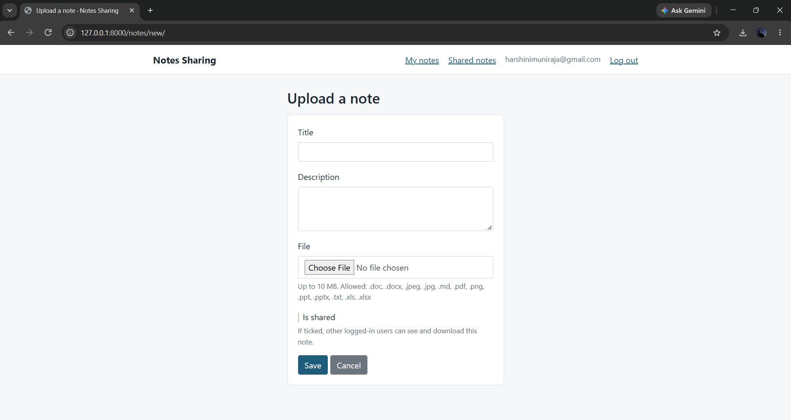
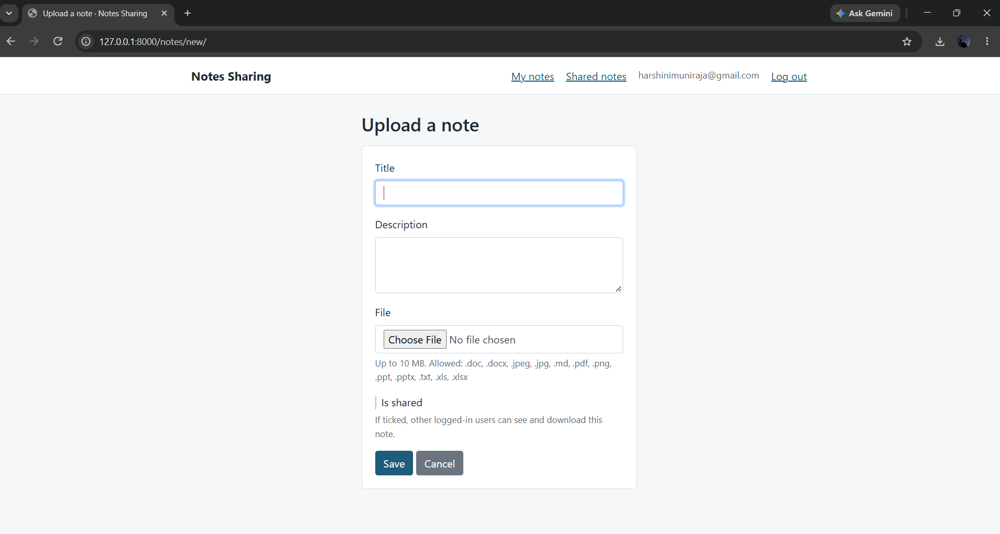
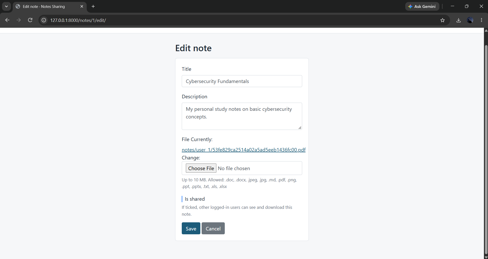
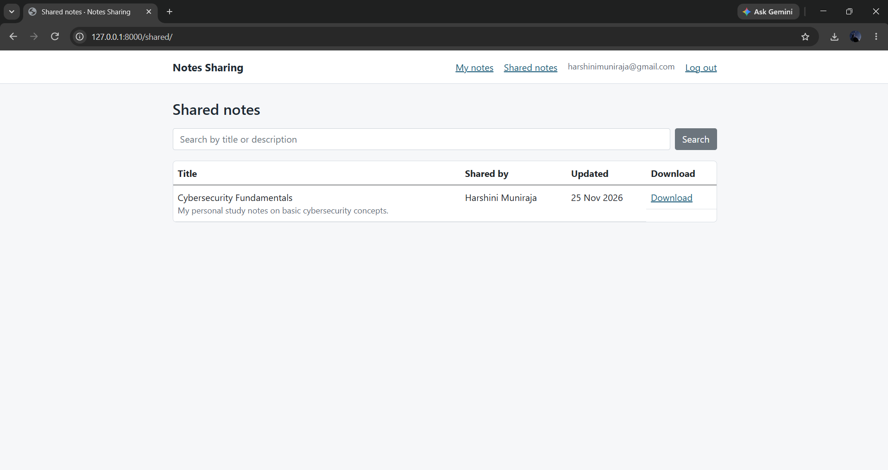

# Notes Sharing Web App (Django)

A Django web application where registered users upload, search, edit and delete their own notes (documents or images) and can optionally share them with other logged-in users.

Originally built as a college capstone (Next Gen Employability Program). This version merges the earlier registration/login project and file-upload project into one codebase and adds access control and safer file handling.

## Features

- User registration, login and logout (Django authentication)
- Upload notes with a title, description and file
- Private by default; tick "share" to make a note visible to other logged-in users
- Search your notes or the shared notes by title or description
- Edit a note (including replacing its file) and delete it
- Admin site for managing users and notes

## Security measures implemented

- Secret key, debug mode and allowed hosts come from environment variables, not the source code
- Passwords are hashed by Django and checked with its password validators; emails must be unique
- Every notes page requires login; a user's private notes return 404 to everyone else
- Files are not served from a public URL. Downloads go through a view that checks permission and sends the file as an attachment
- Uploads are limited to an allow-list of file extensions and 10 MB; stored under random names
- CSRF protection on all forms; deleting and logging out require POST requests
- Optional HTTPS settings (secure cookies, redirect, HSTS) via `DJANGO_HTTPS=True`

## Setup

Requires Python 3.10+.

```bash
python -m venv venv
# macOS/Linux:  source venv/bin/activate
# Windows:      venv\Scripts\activate
pip install -r requirements.txt

# macOS/Linux:  export DJANGO_DEBUG=True
# Windows (PowerShell):  $env:DJANGO_DEBUG="True"
python manage.py migrate
python manage.py createsuperuser   # optional, for /admin/
python manage.py runserver
```

Open http://127.0.0.1:8000/ and sign up.

For anything other than local development, set `DJANGO_SECRET_KEY` (a long random value), leave `DJANGO_DEBUG` off, and set `DJANGO_ALLOWED_HOSTS`. See `.env.example`.

## Tests

```bash
python manage.py test
```

(Set `DJANGO_DEBUG=True` first, as above.) The tests cover registration, login protection, private versus shared access, upload validation and deletion.

## Project structure

```
notesite/    project settings and URLs
accounts/    registration and login
notes/       note model, upload/search/edit/delete views, validators, tests
templates/   HTML templates
static/      CSS (Bootstrap and app.css)
```

## Known limitations and ideas

- File type checking uses the extension only; there is no malware scanning
- No login rate limiting or account lockout (for example `django-axes` could be added)
- No email verification or password reset by email
- SQLite is used for simplicity; use PostgreSQL for a real deployment
- Ideas: tags or folders, note previews, user-to-user sharing instead of share-with-everyone
## Screenshots

### Login Page


### Upload Notes


### Edit Notes


### Shared Notes


